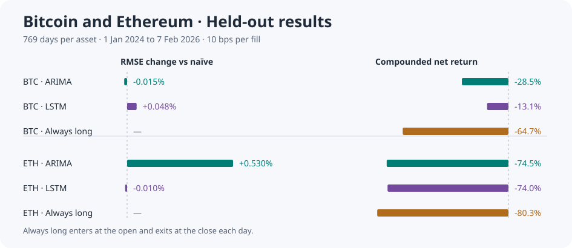

# Bitcoin and Ethereum Price Forecasting

How much do ARIMA and a PyTorch LSTM improve on yesterday’s closing price? This project extends an exploratory analysis of BTC-USD and ETH-USD daily returns and 30-day rolling volatility into a one-day-ahead forecasting experiment and an out-of-sample signal backtest.

## Held-out results

Forecasts cover **1 January 2024 to 7 February 2026** with **769 daily observations per asset**. RMSE and MAE are in USD. Bold marks the lowest error for each asset and metric.

| Asset | Model | RMSE | MAE |
| --- | --- | ---: | ---: |
| BTC-USD | Naïve | 2,056.31 | **1,469.40** |
| BTC-USD | ARIMA | **2,056.01** | 1,470.51 |
| BTC-USD | LSTM | 2,057.29 | 1,475.06 |
| ETH-USD | Naïve | 112.38 | 78.66 |
| ETH-USD | ARIMA | 112.98 | 79.28 |
| ETH-USD | LSTM | **112.37** | **78.56** |

The lowest RMSE improved on persistence by about **0.015% for BTC** and **0.010% for ETH**. ARIMA’s lag coefficients show how each past log return contributes to the prediction. The LSTM can learn nonlinear interactions between returns and volatility, but needed scaled input windows and iterative training for a marginal ETH improvement in this sample. All six RMSEs were within 0.54% of their asset’s naïve baseline.



## Direction and backtest

The forecasts predict whether the next close will rise or fall versus the previous close. The simulated trade uses the next daily open and close, which gives the order a price interval after the signal has been computed. A positive forecast goes long for that session. Other signals sit in cash. Fees are **10 basis points per fill**, paid at entry and exit. The always-long benchmark trades the same open-to-close interval every day.

| Asset | Signal | Close-to-close accuracy | Open-to-close accuracy | Long trades | Net return |
| --- | --- | ---: | ---: | ---: | ---: |
| BTC-USD | ARIMA | 49.0% | 49.2% | 490 | −28.5% |
| BTC-USD | LSTM | 48.6% | 49.0% | 413 | −13.1% |
| BTC-USD | Always long | 50.7% | 51.1% | 769 | −64.7% |
| ETH-USD | ARIMA | 48.5% | 48.4% | 427 | −74.5% |
| ETH-USD | LSTM | 49.5% | 49.4% | 469 | −74.0% |
| ETH-USD | Always long | 51.1% | 51.0% | 769 | −80.3% |

The naïve price forecast implies a flat direction each day, so it makes zero trades. Always long supplies the directional comparison. Both models finished below that benchmark on overall directional accuracy for both assets.

**Regimes.** Each day is labelled using the previous close’s 30-day price trend and rolling return volatility. The median volatility over the development sample sets the quiet/high-volatility threshold separately for each asset. On high-volatility downtrend days, BTC ARIMA predicted the closing direction correctly 58.6% of the time (58 days) and ETH LSTM did so 55.1% of the time (118 days). The overall accuracy was lower, and those subgroup counts are too small to establish a durable edge.

**Costs.** With zero fees, gross return was +90.6% for BTC ARIMA and +98.7% for BTC LSTM, versus −28.5% and −13.1% after fees. ETH ARIMA and LSTM lost money even before fees. The simulation assumes published daily open and close fills without slippage, spread or latency. It measures the sensitivity of these historical signals to turnover and fees under that execution assumption.

## Method

1. Use Yahoo Finance daily open and adjusted close data from 1 January 2018 to 7 February 2026. Compute simple daily returns and their rolling 30-day standard deviation, matching the preceding exploratory analysis. Model daily log returns and convert them to forecast closes using the previous close.
2. Train through 2022, validate on 2023 and reserve 2024 onward for testing. Use a common warm-up for the development sample. Select the ARIMA order and LSTM training duration by validation price RMSE, then refit using train and validation before evaluating.
3. Fit **ARIMA(p,1,0)** with drift by least squares on first differences of log price. Search p ∈ {0, 1, 2, 3, 5, 7}. The selected orders are (5,1,0) for BTC and (7,1,0) for ETH.
4. Fit a one-layer **PyTorch LSTM** with 16 hidden units using 30 past observations of log returns and rolling volatility. Fit scalers on the fitting sample and select from 5, 10, 20 and 40 epochs. The selected durations are 20 epochs for BTC and 5 for ETH.
5. Roll one day at a time using observations available through the previous close. Keep parameters fixed during testing. The naïve baseline carries the previous close forward. Evaluate closing-price error, directional accuracy and fee-adjusted long/flat returns.

## Reproduce

Use Python 3.10 or newer. The published run used Python 3.13 with NumPy 2.4.2, pandas 3.0.0 and PyTorch 2.14.1 on CPU. Random seeds are fixed. Dependency versions, hardware and provider revisions can affect a rerun.

```bash
python3 -m venv .venv
source .venv/bin/activate
python -m pip install -r requirements.txt
python -m unittest -v
python forecast.py
```

The default command fetches Yahoo Finance data. To use the original analysis exports offline, pass their directory instead. The loader accepts `btc_processed.csv` and `eth_processed.csv` or the corresponding `BTC_USD_daily.csv` and `ETH_USD_daily.csv` raw exports. The published run used the processed exports and excluded the final snapshot day.

```bash
python forecast.py --data-dir /path/to/analysis/data/processed
python forecast.py --data-dir /path/to/analysis/data/processed --fee-bps 0 --output-dir results-zero-fees
```

| File | Contents |
| --- | --- |
| [forecast.py](forecast.py) | Data loading, features, held-out evaluation and backtest |
| [models.py](models.py) | ARIMA and PyTorch LSTM training and prediction |
| [forecast_metrics.csv](results/forecast_metrics.csv) | Held-out RMSE and MAE |
| [backtest_metrics.csv](results/backtest_metrics.csv) | Direction, trading performance and sample counts by regime |
| [model_settings.json](results/model_settings.json) | Selected settings, ARIMA coefficients and validation scores |
| `results/predictions.csv` and `results/results.png` | Generated daily forecasts, positions, realised returns and equity chart |
